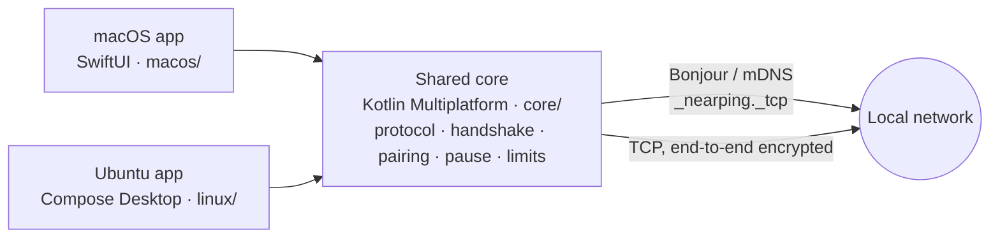

<div align="center">
  
  <h1>NearPing</h1>
  <p><b>Call a colleague who is wearing headphones — over the local network.</b></p>
  <p>English · <a href="README.ru.md">Русский</a></p>

  <a href="https://github.com/Disspear574/NearPing/releases/latest/download/NearPing.dmg"></a>
  <a href="https://github.com/Disspear574/NearPing/releases/latest/download/nearping_amd64.deb"></a>
  <br><br>
  <a href="https://github.com/Disspear574/NearPing/releases/latest"></a>
  
  
  
  
  <a href="LICENSE"></a>
</div>

<br>

Everyone in the office wears headphones, so calling a name across the room does not work.
NearPing lives in the menu bar (macOS) or the tray (Ubuntu): pick a colleague, and they hear a
sound and see a banner. No server, no accounts, nothing leaves the local network.

## Features

- **Ping.** A sound and a banner on the colleague's computer. You see "delivered" and then
  "seen it" when they close the banner.
- **Urgent ping.** Hold the button for a second: a siren plays straight into the current audio
  device, in the headphones, and a window appears above everything with red screen edges.
  It does not go through the notification system, so Focus and Do Not Disturb do not silence it.
- **Pause.** Mute all calls, urgent ones too, from 1 minute to 7 days. Your contacts see the
  pause before they call.
- **Limits.** A ping once every 3 seconds, an urgent one once every 30 seconds; five pings in a
  minute switch to the slow pace too. The receiver enforces the same limits and tells the
  sender when a call was dropped.
- **Contacts by consent.** Everyone on the network is visible, but only people who accepted
  your request can call you. Removing a contact asks for confirmation.
- **Mac and Ubuntu together.** One protocol, so a Mac can call an Ubuntu desktop and back.
- **Open at login**, light and dark themes, English and Russian interface.

## Install

### macOS

1. Download [NearPing.dmg](https://github.com/Disspear574/NearPing/releases/latest/download/NearPing.dmg).
2. Open it and drag **NearPing** to **Applications**.
3. Allow **Local Network** when macOS asks: without it NearPing sees nobody.

> [!IMPORTANT]
> The app is signed ad hoc and not notarized by Apple, so macOS blocks the first launch.
> Open **System Settings → Privacy & Security**, find the message about NearPing and click
> **Open Anyway**. Or remove the quarantine flag in Terminal:
>
> ```bash
> xattr -dr com.apple.quarantine /Applications/NearPing.app
> ```

**Requirements:** a Mac with Apple Silicon and macOS 26 or later.

### Ubuntu

```bash
sudo apt install ./nearping_amd64.deb
```

Or unpack the portable [NearPing-linux-x86_64.tar.xz](https://github.com/Disspear574/NearPing/releases/latest/download/NearPing-linux-x86_64.tar.xz)
and run `./nearping`. Java is included in both.

**Requirements:** Ubuntu 22.04 or later (or Debian 12) on x86_64 with a desktop. The tray icon
needs `gir1.2-ayatanaappindicator3-0.1` and notifications need `libnotify-bin`; the `.deb`
recommends both. Without a tray the app works as a window.

### First call

1. Start NearPing on both computers in the same network.
2. Find the colleague under **Nearby** and click **Add**. They accept the request.
3. Compare the fingerprint in **Settings** if you want to be sure it is the right computer.
4. Click **Ping**, or hold **Urgent Ping**.

If the computers do not see each other, check that the network lets mDNS (UDP 5353) through:
guest Wi-Fi and some VPNs block it. On Ubuntu, **Settings → Discovery network** picks the
interface when there are several.

## How it works



- A device's identity is an Ed25519 key pair created on first launch. Peers are recognised by
  the key, not by name or address.
- Each connection starts with a mutual challenge signed by the identity key and an X25519
  exchange; messages are then sealed with ChaCha20-Poly1305.
- The wire format is a contract between the apps: [docs/protocol.md](docs/protocol.md).

## Build

```bash
make test                       # core tests
make run                        # macOS app (copy macos/Signing.xcconfig.example first)
make dmg                        # build/NearPing.dmg, ad hoc signed
tools/package-linux.sh release  # releases/release/*.deb and *.tar.xz, built on a Mac
./gradlew :linux:run            # Ubuntu app on the current machine
```

Needs JDK 21, Xcode and XcodeGen. Rules for code and git: [docs/CONVENTIONS.md](docs/CONVENTIONS.md),
[docs/GIT.md](docs/GIT.md).

| Path | What it is |
|---|---|
| `core/` | Shared Kotlin core: protocol, crypto interfaces, Engine; macOS XCFramework and JVM |
| `macos/` | SwiftUI menu bar app, XcodeGen project in `macos/project.yml` |
| `linux/` | Compose Desktop app; tray and screen edges are small GTK helpers |
| `tools/` | Linux packaging |
| `scripts/` | DMG and project checks |

## License

[MIT](LICENSE)
