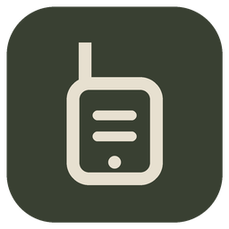
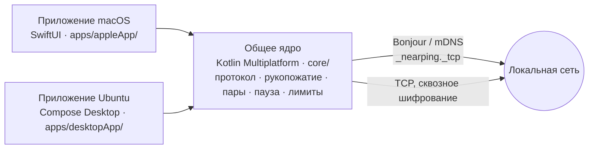

<div align="center">
  
  <h1>NearPing</h1>
  <p><b>Позвать коллегу в наушниках — по локальной сети.</b></p>
  <p><a href="README.md">English</a> · Русский</p>

  <a href="https://github.com/Disspear574/NearPing/releases/latest/download/NearPing.dmg"></a>
  <a href="https://github.com/Disspear574/NearPing/releases/latest/download/nearping_amd64.deb"></a>
  <br><br>
  <a href="https://github.com/Disspear574/NearPing/releases/latest"></a>
  
  
  
  
  <a href="LICENSE"></a>
</div>

<br>

В офисе все в наушниках, и окликнуть человека через комнату не получается. NearPing живёт
в строке меню (macOS) или в трее (Ubuntu): выбрал коллегу — у него звук и плашка. Ни сервера,
ни аккаунтов, ничего не уходит за пределы локальной сети.

## Возможности

- **Ping.** Звук и плашка на компьютере коллеги. Вы видите «доставлено», а потом «увидел»,
  когда он закрыл плашку.
- **Срочный Ping.** Удерживайте кнопку секунду: сирена играет прямо в текущее аудиоустройство,
  то есть в наушники, и поверх всего появляется окно с красными краями экрана. Оно идёт мимо
  системы уведомлений, поэтому «Фокусирование» и «Не беспокоить» его не глушат.
- **Пауза.** Глушит все вызовы, срочные тоже, от 1 минуты до 7 дней. Контакты видят паузу
  до того, как позвать.
- **Лимиты.** Ping раз в 3 секунды, срочный раз в 30 секунд; пять вызовов за минуту тоже
  переводят на медленный темп. Получатель держит те же лимиты и сообщает отправителю, что
  вызов отброшен.
- **Контакты по согласию.** В сети видно всех, но позвать вас может только тот, чей запрос
  вы приняли. Удаление контакта просит подтверждения.
- **Mac и Ubuntu вместе.** Один протокол: Mac зовёт Ubuntu и наоборот.
- **Запуск при входе**, светлая и тёмная тема, интерфейс на английском и русском.

## Установка

### macOS

1. Скачайте [NearPing.dmg](https://github.com/Disspear574/NearPing/releases/latest/download/NearPing.dmg).
2. Откройте и перетащите **NearPing** в **Программы**.
3. Разрешите доступ к **локальной сети**, когда macOS спросит: без него NearPing никого не видит.

> [!IMPORTANT]
> Приложение подписано ad hoc и не нотаризовано Apple, поэтому macOS блокирует первый запуск.
> Откройте **Системные настройки → Конфиденциальность и безопасность**, найдите сообщение про
> NearPing и нажмите **Всё равно открыть**. Или снимите карантин в Терминале:
>
> ```bash
> xattr -dr com.apple.quarantine /Applications/NearPing.app
> ```

**Требования:** Mac на Apple Silicon и macOS 26 или новее.

### Ubuntu

```bash
sudo apt install ./nearping_amd64.deb
```

Или распакуйте переносимый архив [NearPing-linux-x86_64.tar.xz](https://github.com/Disspear574/NearPing/releases/latest/download/NearPing-linux-x86_64.tar.xz)
и запустите `./nearping`. Java включена в оба варианта.

**Требования:** Ubuntu 22.04 или новее (или Debian 12) на x86_64 с рабочим столом. Значку в
трее нужен `gir1.2-ayatanaappindicator3-0.1`, уведомлениям — `libnotify-bin`; `.deb` рекомендует
оба. Без трея приложение работает окном.

### Первый вызов

1. Запустите NearPing на обоих компьютерах в одной сети.
2. Найдите коллегу в разделе **Рядом** и нажмите **Добавить**. Он принимает запрос.
3. Если хотите убедиться, что это нужный компьютер, сравните отпечаток в **Настройках**.
4. Нажмите **Ping** или удерживайте **Срочный Ping**.

Если компьютеры не видят друг друга, проверьте, что сеть пропускает mDNS (UDP 5353): гостевой
Wi-Fi и некоторые VPN его режут. На Ubuntu **Настройки → Сеть для поиска** выбирает интерфейс,
когда их несколько.

## Как это работает



- Личность устройства — пара ключей Ed25519, созданная при первом запуске. Пиры узнаются по
  ключу, а не по имени или адресу.
- Каждое соединение начинается со взаимного вызова, подписанного ключом личности, и обмена
  X25519; дальше сообщения запечатываются ChaCha20-Poly1305.
- Формат обмена — контракт между приложениями: [docs/protocol.md](docs/protocol.md) (на английском).

## Сборка

```bash
make test                       # тесты ядра
make run                        # приложение macOS (сначала скопируйте config/Signing.xcconfig.example)
make dmg                        # build/NearPing.dmg, подпись ad hoc
tools/package-linux.sh release  # releases/release/*.deb и *.tar.xz, собираются на Mac
./gradlew :desktopApp:run       # приложение Ubuntu на текущей машине
```

Нужны JDK 21, Xcode и XcodeGen. Правила кода и git: [docs/CONVENTIONS.md](docs/CONVENTIONS.md),
[docs/GIT.md](docs/GIT.md).

## Лицензия

[MIT](LICENSE)
